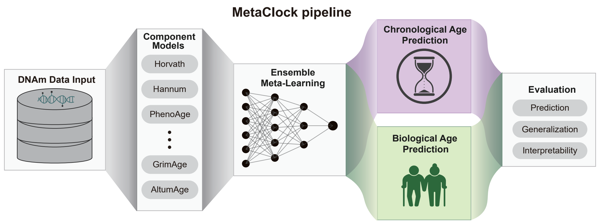

# MetaClock workflow




## Project overview

MetaClock is an integrated framework that combines
predictions from multiple established epigenetic clocks into meta
models. This repository organizes the reproducible downstream workflows used
to evaluate chronological-age prediction, quantify generalization across array
platforms, tissues, and species, and study biological-age associations with
disease and interventions.

## Environment

Install [uv](https://docs.astral.sh/uv/) and create the locked Python 3.11
environment from the repository root:

```bash
uv sync --frozen
```

## MetaClock Python package

The `aging_metaclock` distribution provides the importable `metaclock` package.
Install it from PyPI using Python 3.11:

```bash
python -m pip install aging_metaclock
```

For local development, install from the repository root:

```bash
python -m pip install -e .
```

### Input contract

`metaclock.fit()` accepts an `.h5ad`
file in pyaging's standard orientation:

- rows are samples;
- columns are DNAm or phenotype features;
- feature names are stored in `adata.var_names`;
- the numeric training response is stored in `adata.obs["age"]` by default.

Clocks that use phenotype covariates, such as GrimAge, require those covariates
in the input matrix and `adata.var_names` according to pyaging's input rules.

### Fit and predict

Pass any ordered list of pyaging component-model names.

```
import metaclock

component_model_list = [
    "horvath2013",
    "hannum",
    "dnamphenoage",
]

model = metaclock.fit(
    train_adata,
    component_model_list,
    "elastic_net",
    target="age",
)

predicted_age = model.predict(test_adata)
```

The three positional arguments are the input data, component-model list, and
model architecture. Set `pyaging_dir` when using a specific local pyaging
weight cache.

To run the component clocks without fitting a meta-model:
```python
component_outputs = metaclock.predict_components(
    test_adata,
    component_model_list,
)
```


